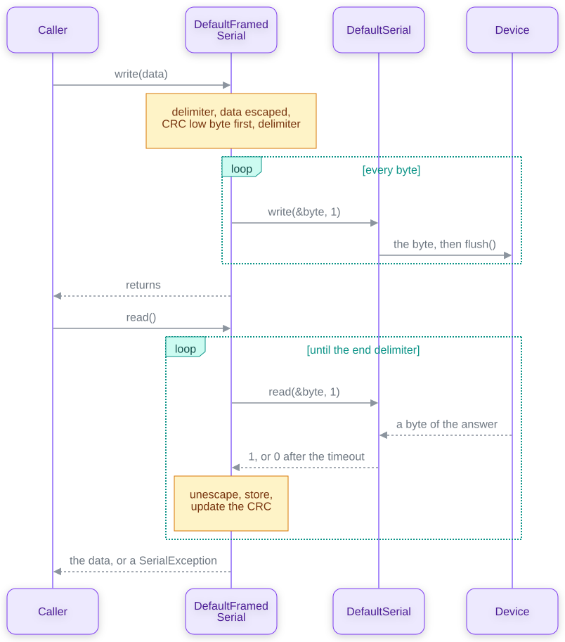

# Framed Serial Architecture

## Table of Contents <!-- omit in toc -->

- [Introduction](#introduction)
- [The Big Picture](#the-big-picture)
- [The Layers](#the-layers)
- [The Protocol](#the-protocol)
- [Writing a Frame](#writing-a-frame)
- [Reading a Frame](#reading-a-frame)
- [The Serial Port](#the-serial-port)
- [The Helpers](#the-helpers)
- [A Request and Its Answer](#a-request-and-its-answer)
- [Tests](#tests)
- [How to Extend Framed Serial](#how-to-extend-framed-serial)
- [Who Uses It](#who-uses-it)
- [Design Decisions and Trade-offs](#design-decisions-and-trade-offs)

## Introduction

This document explains how Framed Serial is built, what each part is responsible for, and where to start when we want to change something. It describes the code as it is: one ROS2 package, `framed_serial`, of about 1,200 lines and 650 lines of tests. It assumes we have read the [README](../README.md), which describes the frame and how to use the library.

It follows one idea: **a call is a whole message or an exception**. The caller of `write()` and `read()` never sees a delimiter, an escaped byte, a CRC or half a frame, and the library never looks inside a message. That is the intent; [Review.md](Review.md) lists where the code falls short of it, a message too long for the buffer above all. Two interfaces carry this out, `FramedSerial` above the framing and `Serial` below it, so that the caller is tested without frames and the framing without a port.

## The Big Picture

A caller, usually the driver of a device, hands a message to a `FramedSerial`. `DefaultFramedSerial` turns it into a frame and passes it, byte by byte, to a `Serial`. `DefaultSerial` is the real port: it forwards each call to the [`serial`](https://github.com/kineticsystem/serial) library, which talks to the device over USB or a UART. The device runs its own implementation of the same frames: this library is the host's side only.

<!-- The source is diagrams/layers.mmd: change it, then run bin/render-diagrams.sh. -->
<p align="center"></p>

The interface of the library, all in the namespace `framed_serial` and under [`include/framed_serial`](../include/framed_serial):

| Name | Type | What it does |
|---|---|---|
| `framed_serial::framed_serial` | CMake target, a shared library | What a package links, after `find_package(framed_serial)`. It exports its two dependencies, `serial` and `rclcpp`. |
| `FramedSerial` | interface | `open()`, `is_open()`, `close()`, `write(bytes)` and `read()`: one message a call. What a driver holds, and what its tests mock. |
| `DefaultFramedSerial` | class | The frames, on any `Serial` given to its constructor, which it owns. |
| `Serial` | interface | The port: `open()`, `close()`, `read()` and `write()` of raw bytes, and the port name, the baud rate and the timeout. |
| `DefaultSerial` | class | The real port, on the `serial` library. |
| `SerialException` | exception | What `read()` and `write()` of `DefaultFramedSerial` throw. Its text is `SerialException: <reason>.` |
| `crc_ccitt()`, `crc_ccitt_byte()` | functions | The CRC-16/KERMIT of a sequence, or updated with one byte. |
| `data_utils` | namespace of functions | Numbers to bytes and back, most significant byte first, and `to_hex()` for logs. |
| `Buffer<T>` | class template | The circular buffer the frames are assembled in. Public because it is a header, not because a caller needs it. |

The library has no ROS interface: no node, topic, parameter or launch file. It is a ROS2 package for the build, `ament_cmake`, and for one log line.

## The Layers

| File | Owns | May know | Must never |
|---|---|---|---|
| [`framed_serial.hpp`](../include/framed_serial/framed_serial.hpp) | The `FramedSerial` interface. | The standard library. | Name a frame, a port or a timeout: a mock of it must stay a few lines. |
| [`default_framed_serial.hpp`](../include/framed_serial/default_framed_serial.hpp), [`.cpp`](../src/default_framed_serial.cpp) | The frame: delimiters, escapes, CRC, the reading state machine, the two 256-byte buffers. | `Serial`, `Buffer`, `crc_utils`, `data_utils`, `SerialException`, and `rclcpp/logging.hpp`. | Include `serial/serial.h`, or read the content of a message. |
| [`serial.hpp`](../include/framed_serial/serial.hpp) | The `Serial` interface. | The standard library. | Mention the `serial` library, except in its comments. |
| [`default_serial.hpp`](../include/framed_serial/default_serial.hpp), [`.cpp`](../src/default_serial.cpp) | The adapter to `serial::Serial`. | `serial/serial.h`: the only files that do. | Hold any logic of the frames. |
| [`serial_exception.hpp`](../include/framed_serial/serial_exception.hpp) | `SerialException`. | The standard library. | |
| [`buffer.hpp`](../include/framed_serial/buffer.hpp), [`crc_utils.hpp`](../include/framed_serial/crc_utils.hpp), [`data_utils.hpp`](../include/framed_serial/data_utils.hpp) and their sources | The helpers. | The standard library. | Include another header of the library. |

The includes follow the table, with no edge against it, and the diagram above shows them all. `default_serial.hpp` includes `serial/serial.h` itself, so whoever creates a `DefaultSerial` compiles against the `serial` library; whoever holds only a `FramedSerial` does not.

Nothing in the library starts a thread or takes a lock. A `DefaultFramedSerial` keeps the frame it is working on in its members, so one object serves one thread at a time: a caller with several threads puts its own lock around a request and its answer.

## The Protocol

The [README](../README.md#the-frame) describes the frame. This table says where each value is, for whoever writes the other end:

| What | Value | Where |
|---|---|---|
| Delimiter, at each end of a frame | `0x7E` | `DELIMITER_FLAG` in [`default_framed_serial.cpp`](../src/default_framed_serial.cpp) |
| Escape | `0x7D`, then the byte XOR `0x20` | `ESCAPE_FLAG` and `ESCAPED_XOR`, same file |
| What is escaped | `0x7E` and `0x7D`, in the data and in the CRC | `add_escaped_byte()`, same file |
| CRC | CRC-16/KERMIT: the table of the reflected polynomial `0x1021`, initial value `0x0000`, computed over the data before escaping | `crc_ccitt_table` and `crc_ccitt_byte()` in [`crc_utils.cpp`](../src/crc_utils.cpp); the initial value is `uint16_t crc = 0` in `read()` and in `write()` |
| Order of the CRC | low byte first | `write()`. Its variables are named the other way round: `crc_msb` holds the low byte and is sent first. |
| Shortest frame | 1 byte of data and the 2 bytes of the CRC | `read()` |
| Longest frame | what fits in 256 bytes | `read_buffer_` and `write_buffer_` in [`default_framed_serial.hpp`](../include/framed_serial/default_framed_serial.hpp) |
| Timeout, baud rate | none of its own: what the caller sets on the `Serial` | [The Serial Port](#the-serial-port) |

The three constants and the table are private to the two source files: a device cannot include them, and keeps a copy by hand.

A frame, byte for byte, from `write_escaped_data` of [`test_default_framed_serial.cpp`](../tests/test_default_framed_serial.cpp): the message `00 71 01 00 00 7E 00` has the CRC `0xA0BA` and goes on the wire as

```
7E  00 71 01 00 00 7D 5E 00  BA A0  7E
```

Sent low byte first, the CRC makes the CRC of the data and the CRC together `0x0000`: the reader computes one CRC over everything between the delimiters and compares it with zero, without knowing where the data ends.

## Writing a Frame

`DefaultFramedSerial::write()` assembles the whole frame in `write_buffer_`, start delimiter, escaped data, escaped CRC, end delimiter, then passes it to `Serial::write()` one byte a call. A call that returns 0 throws `error writing to the serial port`, and the rest of the frame is not sent.

The detail that is easy to break: `Buffer::add()` drops a byte that does not fit, without an error, and the end delimiter is added last. A frame longer than 256 bytes on the wire therefore leaves without its end, and `write()` returns normally. The [README](../README.md#limitations) gives the sizes that always fit.

## Reading a Frame

`DefaultFramedSerial::read()` starts every call from nothing, an empty `read_buffer_`, a CRC of 0 and the state `Waiting`, and asks the `Serial` for one byte at a time until a frame ends or something is wrong:

<!-- The source is diagrams/read-states.mmd: change it, then run bin/render-diagrams.sh. -->
<p align="center"></p>

After an escape, any byte is taken, a `0x7E` included. The buffer holds the data and the CRC unescaped; on a good frame `read()` removes the last two bytes and returns the rest.

`read()` neither retries nor looks for the next frame: it reports, and the caller decides. What matters is what each exception leaves in the port, since the next `read()` starts in `Waiting` with whatever comes next:

| Exception | When | What it has consumed |
|---|---|---|
| `timeout` | `Serial::read()` returns 0, in any state | The bytes read so far, which are dropped. The rest of the frame, if it comes later, is what the next `read()` meets. |
| `start delimiter missing` | The first byte is not `0x7E` | That byte only. Each further `read()` consumes one more, up to a `0x7E`, which may be the end of the damaged frame taken for a start. |
| `incorrect frame length` | A `0x7E` after fewer than 3 bytes, e.g. two delimiters in a row | Up to that delimiter: the reader is then inside the next frame, past its start. |
| `CRC error` | A frame of 3 bytes or more whose CRC is not 0 | The whole frame; the next `read()` starts clean, when both delimiters of the frame arrived. The frame is logged as hex, at the error level, on the logger `DataHandler`. |

So after `start delimiter missing` or `incorrect frame length` the reader stays out of step with the frames until a `read()` ends on `timeout` with nothing left to come. `Serial` has no call to drop the input waiting in the port.

The second detail that is easy to break: a byte that does not fit in `read_buffer_` is dropped, but the CRC is still computed over it. A frame with more than 254 bytes of data passes the check and comes back as its first 254 bytes.

## The Serial Port

`DefaultSerial` creates a `serial::Serial` with that library's defaults, no port, 9,600 baud, 8 data bits, no parity, 1 stop bit, no flow control, and forwards each call. It adds three things:

- **`set_timeout()`** takes seconds, cuts them to whole milliseconds and sets `serial::Timeout::simpleTimeout()`: the time one call to `read()` or `write()` may take. As `DefaultFramedSerial` reads one byte a call, the timeout is per byte, not per frame. Without `set_timeout()` it is 0, and `read()` throws `timeout` unless the byte is already there.
- **`write()`** calls `flush()` after writing, which waits until the bytes have left the computer (`tcdrain()` on Linux). With one byte a call, that is one wait per byte of a frame.
- **Nothing is caught.** `serial::IOException`, `serial::SerialException` and `serial::PortNotOpenedException`, e.g. on a port that does not exist or a device unplugged, pass through `DefaultSerial` and `DefaultFramedSerial` as they are. They derive from `std::exception`, not from `framed_serial::SerialException`: a caller that must survive a lost device catches both.

## The Helpers

| Helper | What it does | Easy to break |
|---|---|---|
| `Buffer<T>` | A circular buffer of a fixed capacity, filled and emptied at either end. | It never throws: `add()` on a full buffer drops the item, `remove()` on an empty one returns an unset value. Its storage is a `std::vector` that is reserved, never resized. |
| `crc_ccitt_byte()`, `crc_ccitt()` | The CRC, by table. | The table must stay the one of the device. |
| `from_int16()`, `to_int16()`, `from_int32()`, `to_int32()` | Integers, most significant byte first, on any host. | |
| `from_float()`, `to_float()` | A 32-bit float, most significant byte first, by reversing the bytes in memory. | Right on a little-endian host only. |
| `from_int8()`, `to_int8()` | Declared in the header, defined nowhere: a call does not link. | |
| `to_hex()`, `to_lower()`, `stoui16()`, `stoui32()` | Bytes as `7E 00 70`, and the parsing of numbers from text, which no caller uses today. | |

`data_utils` is not part of the framing: `DefaultFramedSerial` uses only `to_hex()`. It is here for the callers, which all encode numbers the same way.

## A Request and Its Answer

The longest flow is a request and its answer: the library has no other.

<!-- The source is diagrams/round-trip.mmd: change it, then run bin/render-diagrams.sh. -->
<p align="center"></p>

The two calls are independent: `read()` returns the next frame in the port, whichever request it answers. Pairing them is the caller's protocol.

## Tests

The tests run without a port: `DefaultFramedSerial` against `MockSerial`, a gmock of `Serial` in [`tests/mock/mock_serial.hpp`](../tests/mock/mock_serial.hpp), which plays a frame byte by byte or records the bytes written.

| Test | Cases | What it covers |
|---|---|---|
| [`test_crc_utils`](../tests/test_crc_utils.cpp) | 1 | Six sequences, with the check value `0x2189` of `123456789`. |
| [`test_data_utils`](../tests/test_data_utils.cpp) | 8 | `int16`, `int32` and `float` to bytes and back, `to_hex()` of bytes, `to_lower()`. |
| [`test_default_framed_serial`](../tests/test_default_framed_serial.cpp) | 10 | The frame written for plain data, for data with a `0x7E` and for a CRC with a `0x7D`; a write that returns 0; a frame read, plain and escaped; the four exceptions of `read()`. |

Run them from the root of the colcon workspace that holds the package:

```
colcon test --packages-select framed_serial
colcon test-result --verbose
```

`colcon test` runs no linter: `ament_lint_auto_find_test_dependencies()` is called in `tests/CMakeLists.txt`, where it registers none. Three GitHub workflows run on every push and pull request: [`industrial_ci.yml`](../.github/workflows/industrial_ci.yml) builds the package and runs its tests, [`ci-ros-lint.yml`](../.github/workflows/ci-ros-lint.yml) runs `ament_copyright`, `ament_lint_cmake` and `ament_cpplint`, and [`ci-format.yml`](../.github/workflows/ci-format.yml) checks the format with `clang-format`. None runs `bin/check-diagrams.sh` yet.

What has no automated test:

- **`DefaultSerial`**: it needs a port. Check it by hand against a device.
- **`Buffer`** on its own: wrapping around, a full buffer, an empty one.
- **A frame longer than the buffers**, written or read.
- **The read after an exception**: each test makes one call to `read()`.
- **A `0x7D` in the data**, `to_hex()` of 16-bit values, `stoui16()` and `stoui32()`.
- **The match with a device**: the frames of the tests are the only reference. A device's firmware is checked against them by hand.
- **The diagrams**: [`bin/check-diagrams.sh`](../bin/check-diagrams.sh) fails when an SVG of `docs/diagrams` is missing or does not match its source. Nothing runs it automatically.

## How to Extend Framed Serial

| To... | Change... |
|---|---|
| change a delimiter, the escape or the CRC | the constants in `default_framed_serial.cpp` or the table in `crc_utils.cpp`, the frames of `test_default_framed_serial`, The Frame in the README, and the firmware of every device: the wire changes at both ends, and nothing in a frame carries a version. |
| allow longer messages | the sizes of `read_buffer_` and `write_buffer_` in `default_framed_serial.hpp`, the Limitations in the README, and the buffers of the device. |
| talk over something that is not a serial port, or to a fake device | a class implementing `Serial`, given to `DefaultFramedSerial`. Nothing else changes. |
| use another framing | a class implementing `FramedSerial`. The callers do not change. |
| add a setting of the port, e.g. the parity | a method in `Serial`, in `DefaultSerial` and in `MockSerial`. Every implementation of `Serial` outside the library breaks until it has it. |
| add a number type | `data_utils.hpp` and `.cpp`, and a case in `test_data_utils`. |
| add or change a diagram | its `docs/diagrams/<name>.mmd`, then [`bin/render-diagrams.sh`](../bin/render-diagrams.sh), outside a container: it needs Node.js and Chrome. Commit the source and the SVG. |

## Who Uses It

Two projects build on the library, each with a driver that holds a `FramedSerial` and a firmware that implements the device's side:

| Project | Host | Device |
|---|---|---|
| [StepIt Motors](https://github.com/kineticsystem/stepit-motors) | `stepit_driver` | a Teensy 4, `src/stepit_mcu` |
| [StepIt Freezer](https://github.com/kineticsystem/stepit-freezer) | `freezer_driver` | an Arduino Nano R4, `src/freezer_mcu` |

Both firmwares keep the three constants in their `SerialPort.cpp` and the CRC table in their `CrcUtils.cpp`, with 200-byte buffers and the port at 9,600 baud; both hosts set a timeout of 0.2 s by default. Their reader is not this one: it skips every byte until a delimiter, and takes a delimiter after fewer than 3 bytes as a new start. Each project pins the commit of the library it is built with in its `.repos` file, and a workspace that holds both builds the library once.

## Design Decisions and Trade-offs

**Two interfaces, one above the frames and one below.** A driver holds a `FramedSerial` and is tested with whole messages; the framing holds a `Serial` and is tested with bytes. The price is a virtual call per byte and a `Serial` interface that repeats the part of `serial::Serial` we use, to be extended by hand.

**Byte stuffing with a delimiter, not a length.** A `0x7E` on the wire is the edge of a frame, except right after a `0x7D`, which only a damaged frame produces, so a reader needs three states, no length field and no timer to find a frame. The price is the size: each `0x7E` or `0x7D` costs two bytes, twice the data at worst.

**A CRC whose check is a comparison with zero.** CRC-16/KERMIT, sent low byte first, lets the reader run one CRC over data and CRC alike. The price of its initial value of 0 is that `0x00` bytes at the start of the data do not change the CRC: `00 71 01 00 00 0B B8` and `71 01 00 00 0B B8` both have `0x1705`, as the frames of the `write` and `read` tests show.

**Exceptions, and no recovery inside.** `read()` reports a bad frame and stops there: whether to send the request again is the caller's decision, as the README says. The price is in [Reading a Frame](#reading-a-frame): after some errors the caller must also empty the port, and can do so only by reading until a timeout.

**One byte a call to the port.** The state machine sees each byte as it comes, and the timeout of the port becomes a timeout per byte. The price is a call to the operating system per byte read, a write and a drain per byte written, and no bound on the time a whole frame may take.

**Fixed buffers of 256 bytes that drop what does not fit.** The buffers never grow, like those of the device at the other end. The price is that a longer frame is cut without an error, on both paths.

**`rclcpp` for one log line.** A frame that fails its CRC is logged with its bytes, which the exception does not carry. The price is that the library builds only in a ROS2 workspace.

**The constants of the frame are private.** Nothing outside `default_framed_serial.cpp` can depend on them. The price is that a device's firmware, and a test that builds frames, repeat them by hand.
